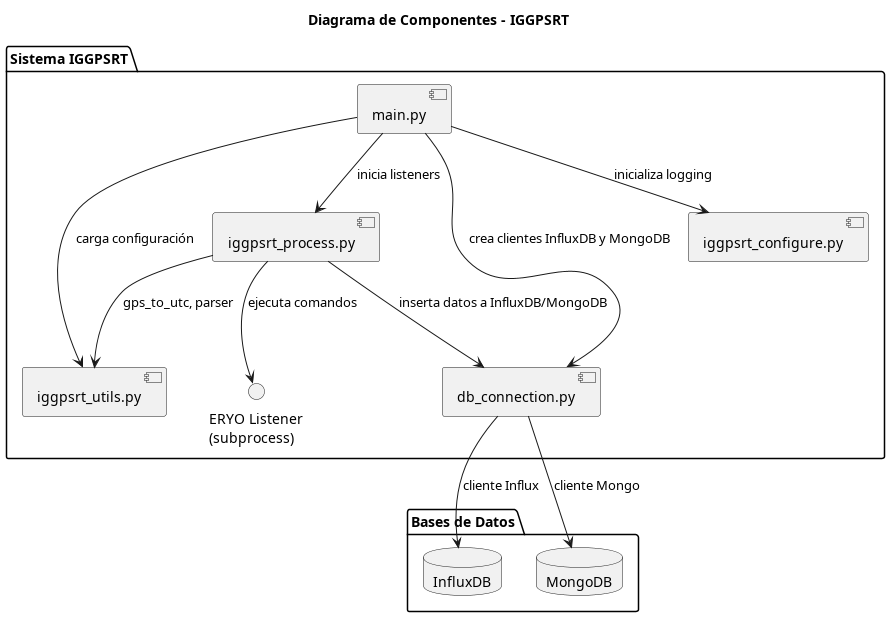
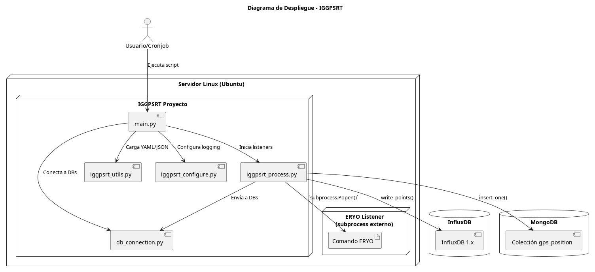
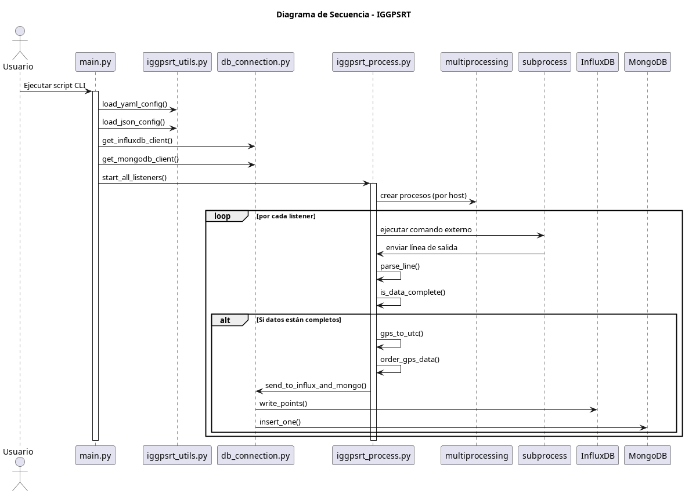

# IGGPSRT

**IGGPSRT** (IG GPS Real-Time) es un sistema diseñado para la **adquisición, procesamiento y almacenamiento automático de datos GPS en tiempo real** desde estaciones GNSS. El sistema ejecuta procesos externos (listeners), extrae y transforma la salida, y almacena los datos estructurados tanto en **InfluxDB** como en **MongoDB** para su visualización o análisis posterior.

---

## ¿Qué hace este proyecto?

- Lee configuraciones desde archivos YAML y JSON.
- Inicia procesos externos (listeners) que recogen datos de estaciones GNSS.
- Extrae, valida y transforma datos como posición XYZ/ENU, número de satélites, y fecha GPS.
- Convierte la hora GPS a UTC.
- Inserta los datos en:
  - **InfluxDB**: para visualización de series de tiempo.
  - **MongoDB**: para almacenamiento estructurado y flexible.
- Usa `multiprocessing` para manejar múltiples estaciones/listeners en paralelo.

---


## Installation

```bash

$ conda create -n iggpsrt python=3.11
$ conda activate iggpsrt
$ conda install influxdb
$ conda install pyyaml
```


## Create the influx database

## Create the mongo DB and collection

```bash

$ mongo -u ADMIN_USER -p ADMIN_PASSWORD

# Create gps DB
> use gps

# Create collection gps_realtime
> db.createCollection("gps_realtime")

## Create user realtime

> db.createUser({
  user: "USERNAME",
  pwd: "USER_PASSWORD",
  roles: [
    {
      role: "readWrite",
      db: "gps"
    }
  ]
})

## Check the conection

$ mongo -u USERNAME -p USER_PASSWORD --authenticationDatabase gps

```


## 🧩 Diagrama de Componentes

Muestra cómo se estructuran los módulos internos del sistema.



---

## 🖥️ Diagrama de Despliegue

Muestra dónde se ejecuta cada parte del sistema y cómo se conectan entre sí.



---

## 🔄 Diagrama de Secuencia

Describe el flujo de ejecución desde el inicio del script hasta la inserción de datos en las bases de datos.



---


## Pruebas en el servidor de desarrollo

- Conectarse al servidor SRVPROGPSR

```
$ cd programas
$ bash eryo_netcat_trpg.sh
```

- Ejecutar localmente en la pc de desarrollo

```
$ conda activate iggpsrt
$ python main.py 

```

- Verificar el funcionamiento revisando los logs

```
$ tail -f iggpsrt.log 

```